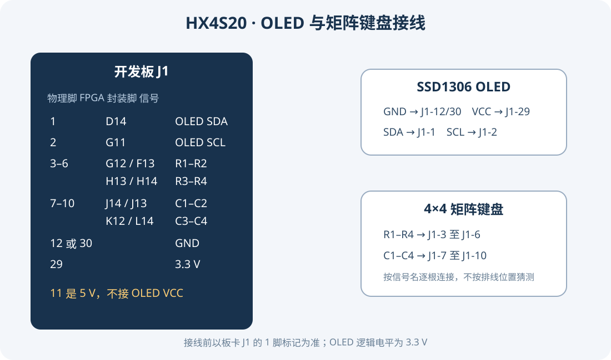

# HX4S20 TF 卡多媒体播放器

本仓库只维护 OLED＋4×4 矩阵键盘这一版。播放器运行在安路 HX4S20（EG4S20BG256）开发板上，从 FAT32 TF 卡读取 720×720 BMP 图片或预转换 RV 视频，经 SDRAM 帧缓存输出到 HDMI。SSD1306 OLED 显示文件菜单和播放状态；矩阵键盘负责全部操作。

## 当前版本

- 工程：[`prj/TF_MEDIA_OLED.al`](prj/TF_MEDIA_OLED.al)
- 顶层：[`rtl/tf_media_oled_top.v`](rtl/tf_media_oled_top.v)
- 可下载固件：[`release/TF_MEDIA_OLED.bit`](release/TF_MEDIA_OLED.bit)
- 接线与按键：[`docs/OLED与矩阵键盘.md`](docs/OLED与矩阵键盘.md)
- 数据通路和帧缓冲时序：[`docs/系统结构与时序.md`](docs/系统结构与时序.md)
- 字幕格式：[`docs/外部字幕.md`](docs/外部字幕.md)



## TF 卡媒体格式

TF 卡使用 FAT32，支持的 BMP、RV 视频和可选同名 SRT 字幕放在根目录。图片使用 720×720、24 位、无压缩 BMP。RVF1 不带音频；RVF2 可包含 12 kHz 单声道 μ-law 音轨。独立 WAV/MP3 文件可出现在菜单中，但当前固件不解码播放。

转换工具：

```bash
python3 tools/convert_image_oled.py photo.jpg PIC01.BMP --fit contain
python3 tools/convert_video.py input.mp4 output.RV --size 720x720 --audio-rate 12000 --fit contain --fps 5 --audio
python3 tools/prepare_srt.py input.srt OUTPUT.SRT
```

竖图转换时会自动顺时针旋转 90°，再按 `contain` 保留画面比例并补黑边。详细参数见 [OLED 与矩阵键盘使用说明](docs/OLED与矩阵键盘.md)。

## 下载和构建

在 BitWriter 中选择 AL-LINK、`PROGRAM_SRAM` 和 1 MHz，加载 `TF_MEDIA_OLED.bit`。固件写入 SRAM，断电后需要重新下载。

构建需要安路 TD 6.2.1 和对应器件许可证：

```bash
TD_BIN=/你的TD安装目录/bin/td.sh bash prj/build_tf_media_oled.sh
```

字体和参考 IP 的来源说明见 [第三方声明](THIRD_PARTY_NOTICES.md)。
