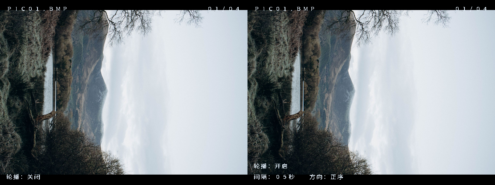

> 咖啡广告场景演示包：[COFFEE_DEMO.zip](release/COFFEE_DEMO.zip)，含促销字幕固件、18 秒带音乐视频和三张海报。[电脑视频预览](release/coffee_demo/COFFEE_PREVIEW.webm)；[烧录、复制与演示步骤](docs/咖啡广告演示.md)。画面由 image_gen 生成，视频采用慢速镜头动画，配乐自制；媒体检查和完整固件时序通过，尚未实板验证。

> 本地扩展版下载文件：[TF_MEDIA_FEATURES.bit](release/TF_MEDIA_FEATURES.bit)。已加入图层字幕、三种图片转场、50%/100%/200% 图片缩放及实际音轨八频段可视化；完整编译与最终时序通过，尚未实板验证。新按键、实现范围和验证状态见 [扩展加分功能](docs/扩展加分功能.md)。

> SW4 显示修复版（2026-10-28）：[TF_MEDIA_SW4_R2.bit](release/TF_MEDIA_SW4_R2.bit)。SW4 拨上隐藏播放状态、文件名与操作提示，拨下显示，文件菜单保留。R2 完整布局布线和最终时序通过，用户已反馈实板成功；各功能逐项验收未记录。[验证结果与实板测试步骤](docs/SW4显示异常排查.md)。

# 安路 FPGA TF 卡图片与视频播放器

## 本地新增：按键文件菜单

已加入 TF 卡根目录统一文件菜单，BMP 图片、RV 视频和 WAV/MP3/AAC/OGG/WMA/M4A 音频文件按目录顺序混排，最多列出前 32 个普通文件，屏幕以八行列表显示并随选中项滚动。文件图标已改成图片、播放和音符样式，并以青色标出选中行。KEY2/KEY3 在列表中上下移动，播放图片时切换上一张/下一张；KEY4 短按打开图片或视频、播放中暂停/继续，长按返回菜单。SW1 开启图片轮播并自动跳过非图片，SW2 选择 5/10 秒间隔，SW3 控制方向。音频文件目前只能浏览，尚不能独立播放；8 频带音频频谱模块保留在源码中，但为保证当前显示稳定，最新可用 bit 暂未接入该模块。按显示器厂家的答复，屏幕触控不能接入本 FPGA；播放界面使用中文状态和实体按键提示。本地候选下载文件为 [`release/TF_MEDIA_BROWSER.bit`](release/TF_MEDIA_BROWSER.bit)，已用 TD 6.2.1 完成综合、布局布线及时序检查；实板验证待做，本次未上传 GitHub。操作与限制见 [文件菜单说明](docs/触控文件浏览器.md)。

## 此前合并播放器进度（触控文件菜单加入前）

- 用户已确认移动测试彩条正常播放，且 HDMI 音频已经出声；图片/视频播放及有声音轨的主要任务基本完成。
- 此前下载文件为 [`release/TF_MEDIA_SWITCH_FIX.bit`](release/TF_MEDIA_SWITCH_FIX.bit)，工程为 `prj/TF_MEDIA.al`。按键静音、长按和组合键切换已接入；该 bit 不含顶部所述文件菜单。
- 完整综合、布局布线和最终时序通过，SWNS 0.990 ns、HWNS 0.011 ns；视频/音频转换器共 15 项 Python 测试通过。RTL 仿真因缺少 iverilog/vvp 未运行。
- 最新音乐测试是 16 秒《欢乐颂》合成旋律与动态琴键，附 WAV 试听；生成方式见下文。音轨数据已检查；用户已确认当前播放器实板出声，未单独记录音乐测试文件的实板验证结果。

具体进度及验证边界见 [当前进度](docs/当前进度.md)。本地提交与 GitHub 上传状态分别确认；此前推送因连接失败尚未完成。

## 图片与视频合并版

新工程 `prj/TF_MEDIA.al`，顶层 `tf_media_top`；通过编译及时序检查后的下载文件为
`release/TF_MEDIA_SWITCH_FIX.bit`（此前静音、组合键切换版）。默认图片模式，KEY4 长按超过 1 秒切换图片/视频，
短按松手后控制图片轮播或视频暂停/继续。KEY2/KEY3 在图片模式保持下一张/上一张，
KEY2 在视频模式从头播放。KEY1 复位回图片模式。
也可同时按住 KEY4+KEY2 约半秒切换，切换后松开两键；组合键不会触发轮播或暂停。

SD 卡根目录可同时保留 BMP 图片和 `VIDEO.RV`。两种模式均输出 640×480。带音轨的 RVF2 视频通过 HDMI 输出 48 kHz 单声道音频，
屏幕耳机口可接有源音箱，暂停、重播、循环同时控制声音；图片和旧 RVF1 文件静音。
用户已确认当前播放器 HDMI 音频实际出声。
转换命令和测试文件生成见 [视频音频播放](docs/视频音频播放.md)。
详细准备、按键与验证情况见 [图片视频合并播放](docs/图片视频合并播放.md)。
下文历史图片功能及测试音说明对应独立的 `TF_IMAGE` 工程。

此前的 GT911 触控实验只作历史记录；本显示器不能把触控接入 FPGA。当前文件菜单版改由开发板按键操作，见本文开头及[文件菜单说明](docs/触控文件浏览器.md)。

## 图片播放与视频播放怎么切换

以下操作适用于 `release/TF_MEDIA_SWITCH_FIX.bit` 合并版。TF 卡使用 FAT32，根目录同时放入图片 BMP 和视频 `VIDEO.RV`。图片须为 640×480、24 位、无压缩、正高度 BMP；视频须预转换为 RVF1（无声）或 RVF2（有声），不能直接播放 MP4。

上电运行合并版后默认进入图片模式，切换时无需重新烧录，也无需更换 TF 卡。

- **图片 → 视频**：同时按住 **KEY4 + KEY2 约半秒**，然后将两键全部松开；程序切换到视频并开始播放。
- **视频 → 图片**：再次同时按住 **KEY4 + KEY2 约半秒**，然后将两键全部松开。
- **单键切换方法**：单独长按 **KEY4 约 2 秒**再松手，也能在两种模式间切换。程序门限约为 1 秒，按住 2 秒更容易操作；持续按住只切换一次。
- **短按 KEY4 不切换模式**：在图片模式开关自动轮播，在视频模式暂停或继续；短按动作在松手后生效。

| 按键 | 图片模式 | 视频模式 |
|---|---|---|
| KEY1 | 复位，回到图片模式 | 复位，回到图片模式 |
| KEY2 | 下一张 | 从头重播视频 |
| KEY3 | 上一张 | 无播放控制动作 |
| KEY4 短按并松手 | 开启/停止自动轮播 | 暂停/继续视频及声音 |
| KEY4 长按约 2 秒 | 切到视频 | 切到图片 |
| KEY4 + KEY2 同时按约半秒 | 切到视频 | 切到图片 |

组合键每次切换后必须松开两键，再进行下一次操作。有声 RVF2 在视频播放时输出 HDMI 音频，暂停时声音也暂停；图片模式和无声 RVF1 不播放音轨。SRAM 下载后须保持供电，断电会加载 Flash 中的程序；需要开机仍运行此版本时，应将同一最新 bit 文件写入 Flash。

## 此前版本上板与音乐测试

1. TF 卡使用 FAT32。将预转换文件命名为 `VIDEO.RV`，放到卡根目录；MP4/AVI/MKV 不能直接播放，也不能只改后缀。
2. 安全弹出 TF 卡，开发板断电插卡，再上电。
3. BitWriter 删除旧列表项，添加 `release/TF_MEDIA_SWITCH_FIX.bit`，选择 **AL-LINK / PROGRAM_SRAM / 1 MHz**，Run 后等待成功。SRAM 下载后保持供电，断电会重新加载 Flash 中的程序。
4. 默认图片模式。同时按住 KEY4+KEY2 约半秒后松开两键，或只按住 KEY4 约 2 秒，等待视频开始。短按 KEY4 暂停/继续，单按 KEY2 重播；组合键再次切回图片。

生成容易辨认的音乐测试文件（Python 标准库，无需 ffmpeg）：

```bash
python3 tools/make_music_demo.py release/music_ode_to_joy
```

输出 `release/music_ode_to_joy/VIDEO.RV` 和电脑试听用的 `ODE_TO_JOY.wav`。将此 VIDEO.RV 替换到卡根目录即可，无需重新编译 FPGA。输出目录若已有文件，生成器会拒绝覆盖，可改用新目录。生成媒体不纳入 Git。

有声 RVF2 需要合并播放器；旧独立 `TF_VIDEO.bit` 只支持无声 RVF1。移动彩条的有声版与无声版画面相同，不能靠画面判断有无音轨。

以下为历史独立图片/视频工程说明，当前合并版以以上操作为准。

## 历史独立图片播放器

基于康芯 HX4S20 开发板（安路 EG4S20BG256）的图片播放器，使用 TF 卡读取 BMP，经 SDRAM 帧缓存输出到 HDMI。

## 已实现功能

- FAT32 根目录自动扫描，支持任意文件名及大小写 BMP 扩展名，最多播放前 32 张有效图片。
- 支持目录、图片的碎片化 FAT 簇链；跳过不支持的 BMP 头部，出现读卡异常时显示中文提示。
- KEY2/KEY3 双向切图；KEY4 开关轮播；SW1/SW2 选择 2/5/10/20 秒间隔；SW3 选择正序或倒序。
- 黑色背景的十二点加载动画，照片在完整帧边界切换。
- 透明悬浮文字：左上角文件名、右上角序号/总数、左下角轮播状态；仅开启轮播时显示间隔和方向，正常提示约 2 秒后隐藏。
- 八位数码管显示 `01 OF 04`，每次按键蜂鸣提示。
- 冷启动等待及失败重试，两个 HDMI 接口输出相同画面。

HDMI 当前输出图片、加载动画及内置测试音：48 kHz、24 位双声道、1 kHz 正弦音，响半秒、静音半秒循环。使用 **HDMI_B** 接显示器，并从显示器耳机口验证声音。TF 卡 WAV 音频读取和视频文件解码尚未实现，蜂鸣器仍用于按键提示。



上图从中文 OSD 的 RTL 仿真采集：左图关闭轮播，仅显示状态；右图开启轮播，多显示一行间隔和方向，图片背景透过文字空白。

## 视频播放开发版

新增独立工程 `prj/TF_VIDEO.al`：从 TF 卡根目录 `VIDEO.RV` 连续播放预转换视频，
640×480、RGB332、1–5 fps，默认推荐 3 fps，双缓冲、循环播放、KEY4 暂停/继续。
音频由外接设备播放，视频工程 HDMI 静音；本版不保证音画同步。
MP4 等文件需要电脑端预转换，不能直接复制后播放。

```bash
python3 tools/convert_video.py input.mp4 VIDEO.RV --fps 3
# 无 ffmpeg 时先生成移动测试图案：
python3 tools/make_video_demo.py VIDEO.RV
TD_BIN=/你的TD安装目录/bin/td.sh bash prj/build_tf_video.sh
```

TF 卡准备、状态码、格式、带宽限制和验证情况见 [视频播放说明](docs/视频播放.md)。

## 目录

```text
constraints/   引脚和时钟约束
rtl/           自编写逻辑、内置字库及板卡参考底层模块
prj/           TD 工程、PLL IP 和编译脚本
sim/           文件解析、按键、数码管和中文界面仿真
media/         可直接写入 TF 卡的四张 BMP、原图及来源记录
tools/         内置中文点阵字库生成工具
release/       最新 TF_IMAGE.bit
docs/          使用说明、修正记录、验证摘要及第三方字体声明
```

## 使用方法

TF 卡格式为 FAT32，将 `media/PIC01.BMP` 至 `PIC04.BMP` 放在根目录。也可以使用自己的图片：必须是 **640×480、24 位 RGB、无压缩 BI_RGB、正高度 BMP**。程序按目录项顺序播放，不按文件名排序，最多收录前 32 张有效图片。

开发板断电插卡，上电后使用 BitWriter 添加 `release/TF_IMAGE.bit`，选择 **AL-LINK、PROGRAM_SRAM、1MHz** 下载。确认画面正常后可使用 **PROGRAM_FLASH、1MHz** 固化同一文件。

| 控件 | 功能 |
|---|---|
| KEY1 | 复位到第一张，并停止轮播 |
| KEY2 / KEY3 | 下一张 / 上一张，加载时忽略切图 |
| KEY4 | 启动 / 停止自动轮播 |
| SW1 / SW2 | 间隔：下下 2 秒；SW1 上 5 秒；SW2 上 10 秒；都上 20 秒 |
| SW3 | 下：正序；上：倒序 |

当前 TF_MEDIA 合并播放器已关闭按键蜂鸣器；用户开发板只有四路拨码，旧版 SW5/SW6 操作说明不适用。HDMI 视频音轨不受影响。

显示间隔从照片真正显示后开始计时，加载期间暂停。KEY2/KEY3 手动切图不会关闭已开启的轮播。图片文件的目录顺序、具体错误及重试行为见 [自动扫描与屏幕提示](docs/自动扫描与屏幕提示.md)。

## 编译

在 TD 中打开 `prj/TF_IMAGE.al`，顶层为 `tf_image_top`。工程文件使用相对源码路径；生成的中文字库已包含在源码中，无需安装字体或 Python 库。

Linux 命令行编译：

```bash
TD_BIN=/你的TD安装目录/bin/td.sh bash prj/build_tf_image.sh
```

本项目必须使用 **TD 6.2.1**（历史版本 Build 175876；触控整合使用 Build 178840），设备 EG4S20BG256，编译需要已安装的 TD 工具及许可证。脚本优先使用 `TD_BIN`，其次使用 `~/.local/opt/TD_6.2.1_Release_175876_NL/bin/td.sh`，最后查找 PATH 中的 `td.sh`。脚本会拒绝其他 TD 版本，并检查是否生成本次编译的新 bit 文件及最终建立/保持时序是否通过。

编译生成 `prj/TF_IMAGE_Runs/phy_1/TF_IMAGE.bit`。验证时序后可复制到 `release/TF_IMAGE.bit`；编译中间目录与日志已在 `.gitignore` 中排除。

## 仿真

需要 Python 3 及 Icarus Verilog（iverilog/vvp）。这些测试使用合成扇区与逻辑握手，不模拟真实 SPI、SDRAM芯片或显示器。

```bash
bash sim/run_catalog_tests.sh
bash sim/run_ui_tests.sh
bash sim/run_audio_tests.sh
bash sim/run_loader_tests.sh
```

文件名当前显示 FAT 8.3 短名；长文件名显示其短名别名，详见 [中文界面说明](docs/中文界面说明.md)。

可选字库重建需要 Pillow 和 Noto Sans CJK SC。详细流程见 [中文界面说明](docs/中文界面说明.md)，字体声明见 [第三方来源说明](THIRD_PARTY_NOTICES.md)。

## 验证记录

最新中文界面、字体像素、提示时长、错误持续显示和一拍字库输出对齐已通过仿真；动态总数按键、轮播、数码管测试通过。自动目录扫描和 307200 像素读取的验证结果见 [验证记录](docs/验证记录.md)。最新 bit 已完成布局布线与时序检查，实板中文显示需下载后确认。

HDMI 音频结构、接口和实板检查步骤见 [HDMI 测试音说明](docs/HDMI测试音说明.md)。
