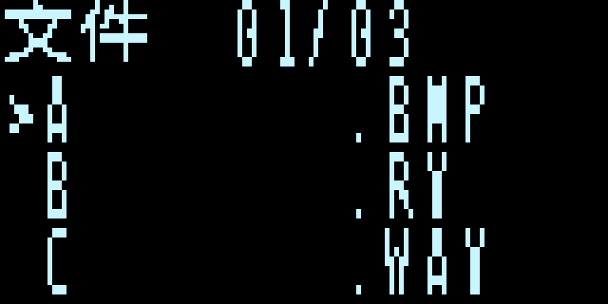

# SSD1306 OLED＋4×4 矩阵键盘版本

独立工程 `prj/TF_MEDIA_OLED.al`，顶层 `tf_media_oled_top`，器件 EG4S20BG256。
OLED 为 128×64、I²C、3.3V 的 SSD1306 模块。主屏仍为原生 720×720 HDMI。
已验证的 `release/TF_MEDIA_720_R2.bit` 保留，不能把旧文件当作本版本。
新下载文件应为 `release/TF_MEDIA_OLED.bit`，对应构建、时序和验证记录在同名 JSON。

HDMI 文件菜单、文件名与操作状态文字已移除。OLED 显示中文菜单、FAT 8.3 文件名、序号、播放/暂停、
图片轮播间隔与方向，以及视频页的字幕和频谱状态。图片按 S8/S12 改变缩放后，右下角提示约 1.8 秒后自动隐藏；视频画面底部显示播放进度条，暂停时冻结。图片、RV 视频及 RVF2 的 HDMI 音轨、图片缩放/转场、
同名 SRT 字幕和实际音轨频谱仍保留。WAV/MP3 等独立音频文件仍只能浏览，不可直接播放。
上电后 OLED 显示文件菜单，菜单期间 HDMI 输出黑屏。启动固定等待已缩至约 100 ms，SD 初始化时钟约 397 kHz。按 S6 打开 BMP/RV 文件后，HDMI 播放选定媒体；按 S4 返回菜单，再按 S4 恢复进入菜单前的媒体，视频从头重新加载。字幕示例为 [COFFEE.SRT](../media/COFFEE.SRT)；需和同名 `COFFEE.RV` 一起放在根目录，当前项目未附带该视频。

## 接线

按 HX4S20 开发板手册第 12–13 页 J1 引脚表核对；J1 编号以板上 1 脚标记和缺口为准。
模块针脚顺序各厂不同，必须根据功能标记逐根接，不可把 OLED 四针直接插进 J1。

| 模块信号 | 开发板 J1 物理脚 | FPGA 封装脚 |
|---|---:|---|
| OLED SDA | 1 | D14 |
| OLED SCL | 2 | G11 |
| 键盘 R1 | 3 | G12 |
| 键盘 R2 | 4 | F13 |
| 键盘 R3 | 5 | H13 |
| 键盘 R4 | 6 | H14 |
| 键盘 C1 | 7 | J14 |
| 键盘 C2 | 8 | J13 |
| 键盘 C3 | 9 | K12 |
| 键盘 C4 | 10 | L14 |
| OLED GND | 12 或 30 | GND |
| OLED VCC | 29 | 3.3V |

J1 第 11 脚是 5V，不用于本方案。OLED 的 I²C 上拉必须接至 3.3V；模块通常自带上拉。
行线使用开漏扫描，未选中的行高阻；列线启用 FPGA 内部上拉。
键盘接线使用逻辑行列名 R1–R4/C1–C4；八针端子顺序不能凭外观推断，需按模块标记或通断测量确认。
键盘为 1–16 数字编号时，按扫描位置从左到右、从上到下对应内部编号 0–15：

```text
R1:  1  2  3  4
R2:  5  6  7  8
R3:  9 10 11 12
R4: 13 14 15 16
     C1 C2 C3 C4
```

## 操作

| 键 | 操作 |
|---|---|
| S2 / S10 | OLED 菜单上一项 / 下一项，首尾循环 |
| S6 | 菜单中打开 BMP/RV；播放中暂停/继续视频或图片轮播 |
| S4 | 打开菜单 / 返回播放；菜单中再次按下关闭菜单并恢复媒体 |
| S5 / S7 | 图片播放时上一张 / 下一张 |
| S1 | 图片自动轮播开关；视频播放时切换字幕 |
| S3 | 图片轮播正序 / 倒序；视频播放时切换频谱 |
| S9 | 图片轮播间隔减 1 秒，界面标记 `S9-`，最小 1 秒 |
| S11 | 图片轮播间隔加 1 秒，界面标记 `S11+`，最大 20 秒 |
| S8 | 图片播放时放大：50%→100%→200%，到 200% 停止 |
| S12 | 图片播放时缩小：200%→100%→50%，到 50% 停止 |
| S13 | 从头重播当前视频，同时重置暂停和字幕时间 |
| S16 | 全局复位并重新扫描 TF 卡 |
| S14 / S15 | 预留 |
| 板载 KEY1 | 全局复位并重新扫描 TF 卡 |

板载其他按键和拨码不参与本版本控制。每次按键产生一次动作，长按不重复；多键同时按下按无效处理，
全部松开后重新接受单键。这减少无二极管矩阵的鬼键误操作；不支持多键组合或多键独立并发。

## 显示和资源设计

文件列表显示当前选中项和后面两项。图片状态页标题显示“图片”（暂停时显示“图片 暂停”），轮播间隔默认 5 秒；在“轮播、间隔、顺序”下方显示快捷键 S1、S9-、S11+、S3。视频状态页显示字幕和频谱状态，并在其下方标出 S1、S3；视频页不显示图片轮播设置。文件名沿用 FAT 短名，不支持中文长文件名。
SSD1306 自动尝试 7 位地址 0x3C、0x3D；未收到 ACK 时延迟重试，不阻塞媒体控制。
没有 FPGA 整屏 OLED 帧缓存：控制器自带显存，FPGA 每次通过共享字库生成一个竖向字节并发送。
中文 16×16，ASCII 使用独立 8×8 字库并纵向放大为 8×16，四行；页面约每 0.1 秒刷新一次。
OLED 与字库端口独立于媒体重载复位，打开新文件时不重新初始化整个 OLED。

TF 卡使用 FAT32。BMP/RV 素材沿用 720 R2 格式。OLED 工程的视频帧尺寸必须是 720×720，RVF2 音频采样率为 12 kHz；转换时要显式指定这两个参数，不能使用旧工程的默认 640×480、48 kHz 配置。当前播放器支持 1–5 fps，5 fps 更流畅，但播放连续性仍受帧读入与 SDRAM 缓冲影响。

转换带音频 MP4 的命令：

```bash
python3 tools/convert_video.py input.mp4 output.RV --size 720x720 --audio-rate 12000 --fit contain --fps 5 --audio
```

`--fit contain` 保留原视频比例并在方形画面内补黑边。播放器目前按视频帧分块读取音频，帧切换准备期间可能短暂静音；提高到 5 fps 不会消除这个间隙。字幕格式和字库限制见 [外部字幕](外部字幕.md)，TF 卡根目录需要同名 `.RV` 与 `.SRT`。
## 构建与验证

```bash
bash sim/run_oled_tests.sh
TD_BIN=/你的TD6.2.1/bin/td.sh bash prj/build_tf_media_oled.sh
python3 tools/package_media_oled.py
```

测试涵盖 16 键位置、消抖、长按只触发一次、多键拒绝和松手重置；实际顶层的系统时钟控制逻辑；
SSD1306 0x3C/0x3D 地址、ACK/重试、初始化、分页与菜单、图片播放、视频播放三屏共 3072 个字节（与参考像素逐字节比较）。
控制逻辑测试把 PLL/SD/HDMI 当作黑盒，不能替代真实硬件验证。
构建脚本要求 TD 6.2.1、本次新 bit，以及完整 Routed 建立/保持时间通过。
打包脚本还核对资源、源文件新鲜度和 SHA-256。编译、仿真、时序与实板验收分别记录。

先使用 BitWriter 的 AL-LINK / PROGRAM_SRAM / 1 MHz 下载 `TF_MEDIA_OLED.bit`。
检查 OLED、16 键位置、选文件播放、暂停、轮播、字幕和频谱，再决定写入 Flash。
本版本实板效果等待用户接线后验证，不能由仿真或时序通过推断硬件已验收。

## 本次构建记录（2026-11-03）

- TD 6.2.1 Build 175876，完整综合、布局布线、保持修复和下载文件生成通过。
- 最终 Routed：SWNS **+1.062 ns**、STNS 0、HWNS **+0.024 ns**、HTNS 0。
- 最终资源：LUT **16549/19600（84.43%）**，寄存器 9094/19600，BRAM **64/64**，PLL 2/4，DSP 8/29。
- BRAM 包括独立 ASCII 小字库；OLED 无整屏缓存。存储资源已满，不能把逻辑资源余量当成 BRAM 余量。
- 键盘、实际顶层系统控制（含 1–20 秒间隔边界与 S1/S3 视频控制）、OLED 两种地址及菜单/图片/视频三种界面像素测试通过。
- HDMI PHY 使用独立复位域适配文件，像素侧与串行侧分别同步释放；原厂文件未改。
  异步复位、串行三拍释放、重复复位及与原序列器的 TMDS 位流比较通过。
- SHA-256：`f2d6da070047237f47e86aeb015b5b12149379179c972bdb813b7efcd7494d8e`。
- **尚未实板验证**；所有修改仅保存在本地，未上传 GitHub。



预览由仿真参考字节放大绘制，不是实物屏幕照片。
