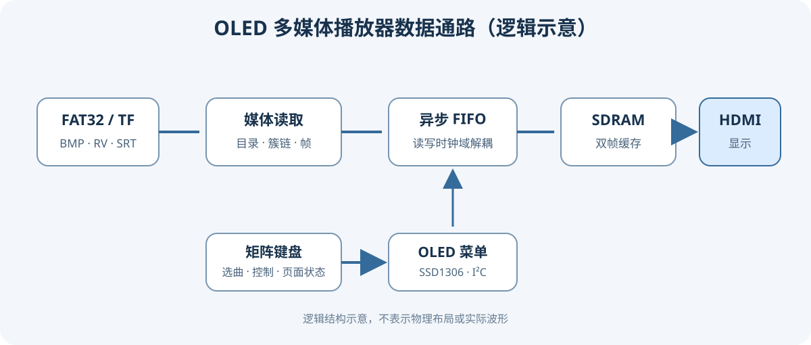

# 系统结构与视频帧时序

本文记录当前 OLED 版工程中可从 RTL 直接核对的媒体数据通路和帧缓冲握手。图为逻辑示意；波形截图应从实际仿真或开发板采集，不能用结构图代替运行证据。

## 时钟、复位与显示时序

- `rtl/tf_media_oled_top.v` 设置画面有效区为 720×720，像素时钟参数为 48 MHz，并连接视频 PLL、存储 PLL、SD 卡与 SDRAM 控制器。
- 当前顶层时序总计为 940×768：水平同步 20 像素、后沿 100、有效区 720、前沿 100；垂直同步 8 行、后沿 20、有效区 720、前沿 20。帧缓存只存有效区像素，消隐区由扫描时序产生。
- `ready_clock` 在启动控制完成且视频、存储 PLL 锁定后释放相关域复位。SD、存储、像素域各自使用三级同步移位寄存器同步释放复位。异步复位断言，按各自时钟同步释放。
- OLED 菜单 I²C 使用像素时钟域的控制复位，不参与 SDRAM 帧缓存复位。

## 帧写入、提交与呈现

帧长为 `720 × 720 = 518400` 个像素字。顶层为两帧分配连续的 SDRAM 地址区：bank 0 从字地址 0 开始，bank 1 从字地址 518400 开始。写地址选择由 `video_sd & write_bank` 控制，读地址选择由 `video_pixel & read_bank` 控制。

1. `rtl/fat32_video_reader.v` 读完一帧后发出 `write_req`，进入 `WAIT_WRITE`，等待帧 FIFO 写入端的 `write_ack`。
2. 随后进入 `WAIT_COMMIT`，等待 SDRAM 写完成握手 `memory_done`；RVF2 还需等本帧音频数据读入完成。条件满足后才翻转 `frame_toggle`。
3. 读取器等待同步回来的 `consumed_toggle` 与本帧 toggle 一致，才释放当前写 bank 并开始下一帧。未确认前不会覆写显示端尚未接收的帧。
4. `frame_toggle` 在顶层像素域经三级同步后送入 `rtl/video_frame_presenter.v`。呈现器只在垂直消隐窗口、没有未完成读请求且新帧已就绪时切换 `read_bank`；等待读侧应答并完成预取后才开始显示新帧。视频带音轨时还会检查音频缓冲状态。

该握手将“SD 卡完整读完一帧”“写入 SDRAM 完成”和“显示端实际切换到新帧”作为三个不同事件处理。其 RTL 位置分别是视频读取器的 `WAIT_WRITE`/`WAIT_PRESENT` 状态、顶层的 toggle 同步器，以及呈现器中的 VBlank/read-ack 状态。

## SDRAM FIFO 写入

SDRAM FIFO 写通路位于 `rtl/vendor/tf_reference/SD/frame_fifo_write.v`。此工程采用 `SAFE_BURSTS=0`，突发长度因此固定为 `BURST_SIZE`；当 FIFO 和 SDRAM 写控制允许时，模块以突发事务搬运像素数据。`write_len` 限制每帧总写入字数，两个 bank 的基址由顶层提供。FIFO 缓冲使 SD 读入与 SDRAM 访问能够在各自时钟域推进。

## 建议采集的验证证据

若需在作品说明中展示时序证据，可用 RTL 仿真波形或逻辑分析仪分别截取：

| 证据 | 建议显示的信号 |
|---|---|
| 写请求和仲裁 | `write_req`、`write_ack`、FIFO `rdusedw`、SDRAM `App_wr_en`、`App_wr_addr` |
| 完整帧提交 | `pixel_count`、`WAIT_WRITE` 状态、`frame_toggle` |
| 跨时钟域握手 | SD 域 `frame_toggle`、像素域 `frame_sync`、`consumed_toggle`、`ack_sync` |
| VBlank 换帧 | `vblank`、`read_bank`、`read_req`、`read_ack`、`frame_start` |
| 输出画面 | HDMI 同步、有效区、RGB 数据，以及屏幕实拍图 |

上述 RTL 能说明设计意图和握手机制；它本身不证明特定开发板、显示器或 TF 卡上的实测结果。实测波形应标出采集方式、时钟域和触发条件。
