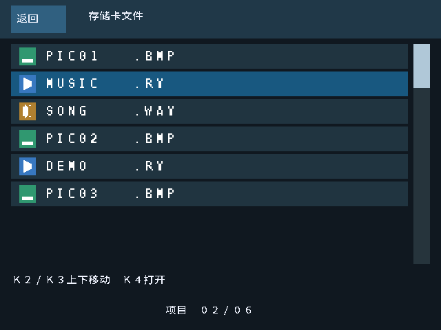
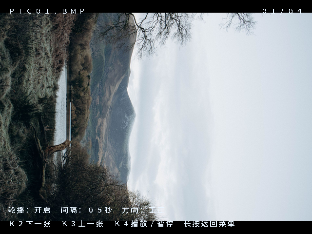

# TF 卡文件浏览器（按键版）

本次源码属于 `prj/TF_MEDIA.al` 合并播放器。显示器厂家确认触控不能接入该 FPGA，因此本版本不启用触控 I²C；文件菜单和播放界面的文字提示均为中文，播放器状态和按键提示直接叠加在画面上，不再显示触控按钮栏。更新后的本地候选 bit 是 [`release/TF_MEDIA_BROWSER.bit`](../release/TF_MEDIA_BROWSER.bit)，构建摘要见 [`release/TF_MEDIA_BROWSER.json`](../release/TF_MEDIA_BROWSER.json)。





## 操作

- 上电或 KEY1 复位后进入文件菜单，自动扫描 FAT32 卡根目录。
- 列表每次显示八个文件，最多列出前 32 个普通文件，顺序与 FAT 目录一致。选中项移动到可视区域边缘时列表自动滚动，右侧滚动条显示当前位置。
- KEY2 向下/下一项，KEY3 向上/上一项；到列表末尾或开头会循环。KEY4 短按打开所选图片或视频。
- WAV、MP3、AAC、OGG、WMA、M4A 文件会显示名称和音符图标；KEY4 不会打开这些文件，目前也没有独立音频播放器。8 频带 Goertzel 音频频谱模块保留在源码中，但当前可用 bit 暂未接入该模块；音频文件仍只显示在列表中。
- 图片、视频和音频在同一份目录列表中。浏览菜单时 KEY2/KEY3 上下移动；KEY4 短按打开图片或视频，音频目前只显示。播放界面以无底框的中文文字叠加显示文件名、序号、轮播设置和按键提示；图片播放时 KEY2 切换下一张、KEY3 切换上一张，KEY4 短按播放/暂停；视频播放时 KEY4 短按播放/暂停；长按 KEY4 约 1 秒返回文件菜单。
- SW1 拨上开启图片轮播，拨下停止；SW2 拨下每张约 5 秒、拨上约 10 秒，SW3 控制方向。轮播只遍历有效 BMP 图片，自动跳过目录中的视频。KEY4 可暂时暂停/继续轮播；打开新图片会恢复运行状态。
- 图片、视频、音频文件使用不同的折角卡片图标，选中行带青色标记；灰色图标表示其他不支持或头部检查未通过的文件。独立音频文件目前只显示名称，不会交给播放器。
- 播放画面不再显示仿触控按钮栏，操作提示直接叠加在图片/视频上；触控无法连接，按钮操作使用板载按键。打开图片会停止自动轮播；打开视频会从头开始播放，包括重新打开当前视频。
- 增删卡内文件后，重新上电或 KEY1 复位以重新扫描。暂不支持热插拔刷新、子文件夹和长文件名。

## 媒体要求

卡须为 FAT32。文件名显示 FAT 8.3 ASCII 短名，名称区固定八个字符，随后是扩展名；因此短名称与扩展名之间会留空格。中文长文件名显示其短名别名。菜单通过 WAV、MP3、AAC、OGG、WMA、M4A 扩展名识别音频。

图片仍需 640×480、24 位、无压缩、正高度 BMP。视频仍需预转换为 RVF1（无声）或 RVF2（带 mu-law 音轨），不是通用 MP4 解码器。转换方法见 [音视频播放说明](视频音频播放.md)。RV 可用任意合法短文件名，不再仅限于 VIDEO.RV。图片和视频以现有 640×480 HDMI 时序显示。

目录扫描会检查支持格式的头部，完整文件链和帧数据由播放器继续校验。目录扫描异常或无卡超时会显示错误；损坏媒体不保证能播放。当前限制是前 32 个普通文件，包括灰色文件，后面的文件不会出现在菜单中。

## 实现

`fat32_media_catalog.v` 负责一次性扫描与格式检查，将名称、类型、有效 BMP 序号按字节保存在一个双端口 BRAM。查询索引经过同步并预取，按键事件触发打开；像素端在每行起点提前读取类型与名称，保证图标和文件名对齐。目录支持跨扇区、碎片簇链、正常链尾、坏簇/自环检查和无卡超时。扫描结束后元数据保持不变，系统与像素时钟域通过完成同步和 UI 快照读取；切换媒体不会重复清空目录。

`touch_file_browser.v` 负责按键选择、循环和可视窗口滚动。`file_browser_overlay.v` 与同步字库绘制中文菜单、单列文件行、类型图标和滚动条，并沿用现有视频流水线对齐。`audio_spectrum.v` 以 48 kHz RVF2 音轨计算 8 个 Goertzel 频带，`audio_spectrum_overlay.v` 将频带电平画成彩色柱形；独立 WAV/MP3 等文件尚未接入音频播放通路。文件名按 FAT 8.3 短名显示，目前没有生成照片缩略图。

图片加载器增加 QUICK_SELECT：公共目录提供总图片数，加载器按有效 BMP 序号找到目标后直接加载，避免再保存一份完整目录。其他独立图片工程默认关闭这一参数。视频加载器增加可选短文件名匹配，独立视频工程默认仍找 VIDEO.RV。

## 验证与待验收

运行：

```bash
bash sim/run_browser_tests.sh
bash sim/run_touch_tests.sh
bash sim/run_catalog_tests.sh
bash sim/run_media_tests.sh
bash sim/run_video_tests.sh
bash prj/build_tf_media.sh
```

浏览器测试涵盖混合文件、无卡、错误引导扇区、碎片目录、32 文件上限、FAT 扇区末尾条目、BMP 序号、RV 任意文件名、音频扩展名分类、按键选择/打开、连续滚动、列表循环、滚动条、空白区域和不支持格式。SW1 图片轮播和 KEY4 暂停/恢复也经过仿真。预览来自 RTL 像素输出。实际串行 BRAM 预取与直接目录输入的整帧像素对比通过；GT911/I²C 历史模块测试与旧播放器回归分别运行。

本地候选 bit 经过 TD 6.2.1 完整布线与时序检查；具体结果见项目的 `release/TF_MEDIA_BROWSER.json`，新版实板结果尚待验证。先使用 PROGRAM_SRAM 下载 `release/TF_MEDIA_BROWSER.bit`，确认上电进入混排菜单、KEY2/3 移动、KEY4 打开图片/视频或暂停、SW1 轮播只经过图片，再测翻页、多文件播放与上电复位。音频文件应显示金黄色图标，当前不支持独立播放。确认后再烧 Flash。`TF卡错误 10` 表示 FAT32 引导区/分区不符合要求，`13` 表示目录链异常，`14` 表示卡初始化未就绪，`15` 表示已经请求扇区但读取超时；代码只给出诊断方向。14 号超时单独等待约 21 秒，不把上电等待误计入扇区读取超时。屏幕触控不接 FPGA。

空目录诊断：当前卡在 Linux 下的根目录有 `PIC01.BMP` 至 `PIC04.BMP` 和 `VIDEO.RV`，MBR 分区起始 LBA 为 8192，FAT32 根目录首扇区 LBA 为 24576（十六进制 `6000`），首字节是 `50`（ASCII `P`）。三个真实元数据扇区回放到 `fat32_media_catalog` 后可数出 5 个文件。若实板仍显示空目录，屏幕底部显示 `根目录为空 B:xx L:xxxx`：`B` 是板上读到的根目录首字节，`L` 是板上计算的根目录 LBA 低 16 位；与预期 `B:50 L:6000` 比较即可区分 SD 数据读取、地址计算与界面计数问题。这是诊断信息，未代表实板问题已修复。
